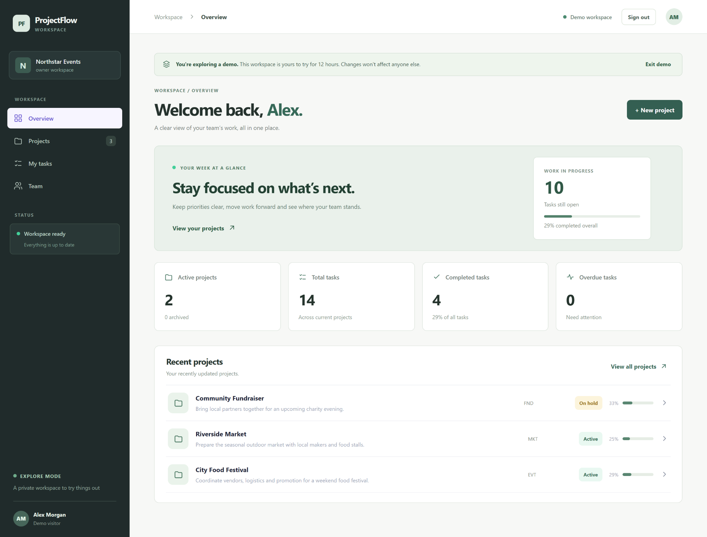
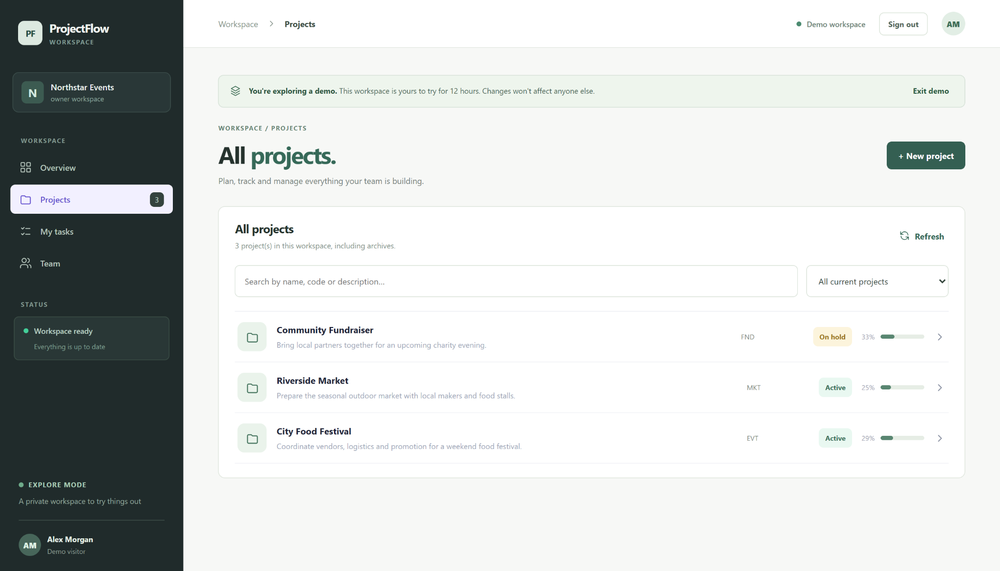
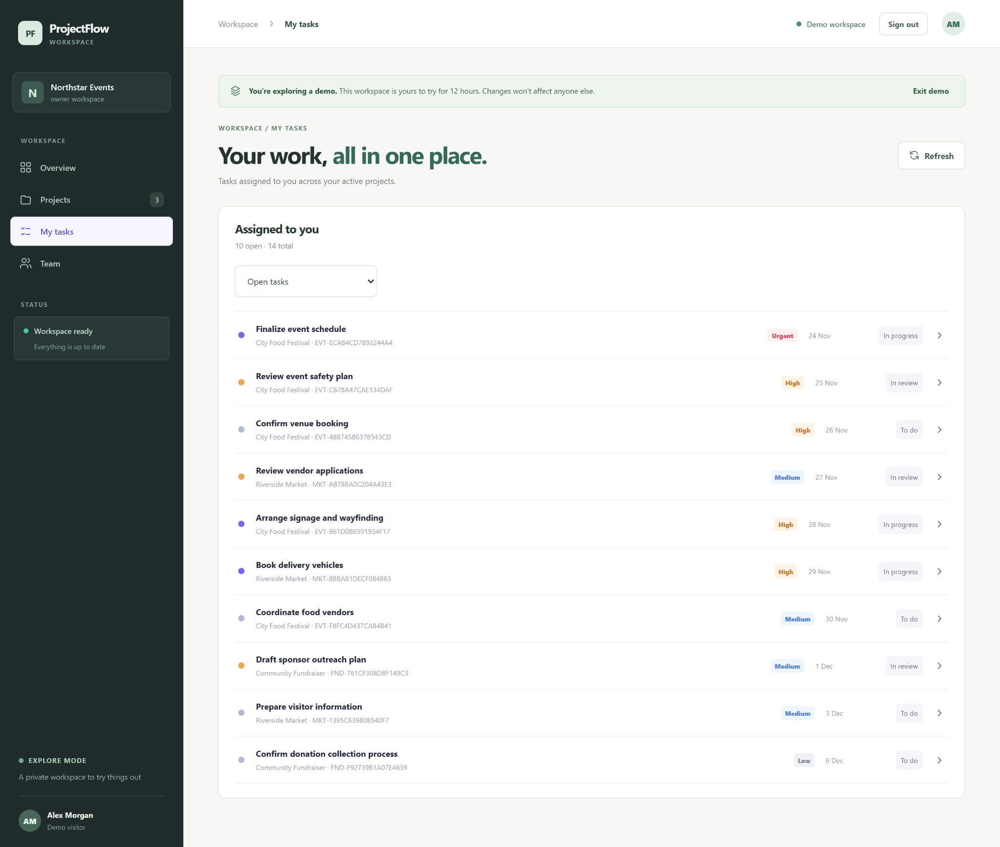
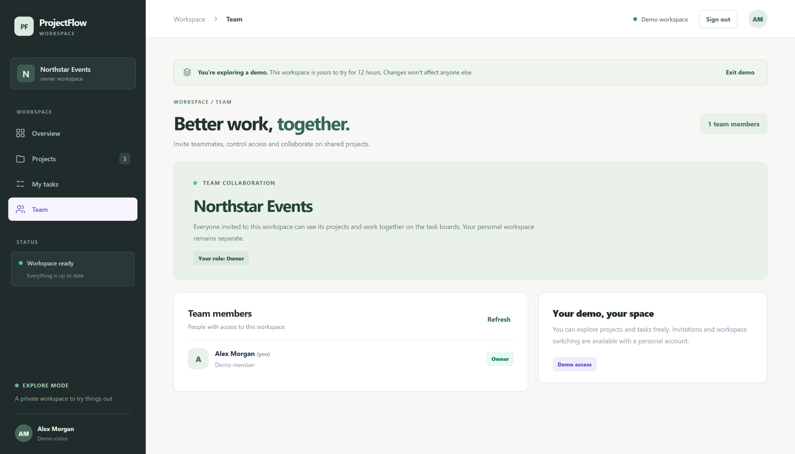

# ProjectFlow

**A collaborative workspace for projects, tasks, and teams.**

ProjectFlow brings project planning, task tracking, and team collaboration into one focused interface. Organize work on a Kanban board, manage multiple projects, and keep track of what needs attention — without switching between tools.

**[Live Application](https://projectflow-client-three.vercel.app/)** · **[Source Code](https://github.com/HubertSleszynski/projectflow)**

> **Try it without signing up:** Open the live application and select **Explore demo workspace**. You'll get a private, prepopulated workspace where you can explore the features and make changes.

## Screenshots

A look inside the **demo workspace**, populated with fictional projects and tasks. You can explore these views yourself using the [live demo](https://projectflow-client-three.vercel.app/).

### Workspace overview

Monitor project activity, completion rates, and the work that needs attention.



### Projects

Keep projects organized, track their status, and find what your team is working on.



### My tasks

See assigned tasks across projects, including priorities, due dates, and current status.



### Team workspace

Manage workspace members and access permissions in one place.



## Features

- **Project management** — create and edit projects, track their status, and archive or delete completed work.
- **Kanban boards** — organize tasks across To do, In progress, In review, and Done, with drag-and-drop movement and ordering.
- **Task details** — assign teammates, set priorities and due dates, and filter tasks to find relevant work.
- **My Tasks** — view work assigned to you across projects.
- **Team workspaces** — collaborate in separate workspaces with Owner, Admin, and Member permissions.
- **Invitations** — invite teammates using email-bound, single-use invitation codes.
- **Authentication** — account registration, sign-in, and database-backed sessions.
- **Guest demo** — explore an isolated workspace with sample projects, without creating an account.

## Tech Stack

| Area | Technologies |
| --- | --- |
| Frontend | Next.js 16, React 19, TypeScript, CSS |
| Backend | Node.js, Express 5, TypeScript, Zod |
| Database | PostgreSQL, Prisma ORM |
| Authentication | Server-side sessions, HttpOnly cookies, scrypt password hashing |
| Deployment | Vercel (frontend and API), Neon (PostgreSQL) |
| Development & CI | npm workspaces, Docker Compose, GitHub Actions |

## Architecture

```text
Browser
   |
   v
Next.js frontend (Vercel)
   |  /api/* — same-origin proxy
   v
Express API (Vercel)
   |
   v
Prisma ORM
   |
   v
Neon PostgreSQL
```

The frontend and API are deployed separately. Next.js forwards `/api` requests to Express, allowing the browser to use a single origin for the application and its session cookies. Authorization and workspace access checks are enforced by the API.

## Getting Started

### Requirements

- Node.js 22 or later and npm
- Docker Desktop or Docker Engine with Docker Compose

### Local setup

1. Clone the repository and install dependencies:

   ```bash
   git clone https://github.com/HubertSleszynski/projectflow.git
   cd projectflow
   npm install
   ```

2. Create the backend environment file:

   ```bash
   cp server/.env.example server/.env
   ```

   The example points to the local PostgreSQL container on port `5433` and sets `APP_ORIGIN` to `http://localhost:3000`.

3. Start PostgreSQL and prepare the database:

   ```bash
   docker compose up -d --wait postgres
   npm run db:generate
   npm run db:deploy
   ```

4. Start the API and frontend in **separate terminals**:

   ```bash
   # Terminal 1
   npm run dev:api
   ```

   ```bash
   # Terminal 2
   npm run dev:web
   ```

Open **http://localhost:3000** and create an account or explore the demo.

> **Windows / Git Bash:** If `npm` does not resolve correctly, use `npm.cmd` instead. Never commit real `.env` files or database credentials.

## Testing

With the local database running and migrations applied:

```bash
npm run verify:all
npm run build
```

`verify:all` runs TypeScript checks, API unit tests, and integration checks covering authentication, projects, tasks, teams, and demo isolation. GitHub Actions also runs the verification workflow on pushes and pull requests.

## Project Structure

```text
client/                  Next.js application and UI components
server/src/              Express API, authentication, and business logic
server/prisma/           Prisma schema and database migrations
server/scripts/          Integration verification scripts
.github/workflows/       CI configuration
docker-compose.yml        Local PostgreSQL service
```

## Deployment

The live application uses two Vercel projects connected to this repository:

| Service | Root directory | Required environment variables |
| --- | --- | --- |
| Frontend (Next.js) | `client` | `API_PROXY_TARGET` — public API origin |
| Backend (Express) | `server` | `DATABASE_URL` — Neon connection string; `APP_ORIGIN` — frontend origin |

The PostgreSQL database is hosted on **Neon**. Apply Prisma migrations with a **direct database connection**; use the appropriate pooled connection for the deployed API. Environment variables are configured in the hosting dashboard, not committed to Git.

## Notes

ProjectFlow is a portfolio application intended to demonstrate full-stack development and collaboration workflows. Demo workspaces are isolated from registered accounts and expire after 12 hours. Before using the application for real customer data, additional production hardening is required, including shared rate limiting for serverless deployments and a review of dependency advisories.

## Author

**Hubert Śleszyński** — Full Stack Developer

[Portfolio](https://hrs-dev.netlify.app/) · [LinkedIn](https://www.linkedin.com/in/hubertsleszynski/) · [GitHub](https://github.com/HubertSleszynski)
